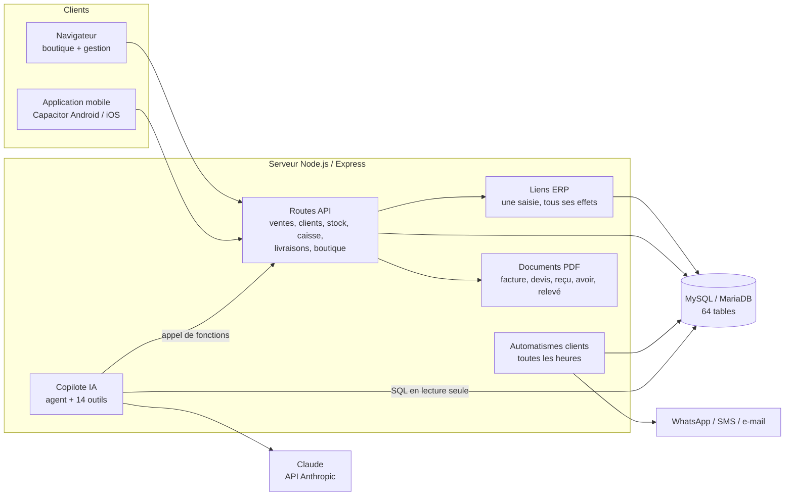

[← Retour au profil](README.md) · [Présentation de l’ERP](ERP.md) · [Essayer la démo](https://fatoumayorofall-dev.github.io/demo-erp/)

# Structure de l’application Allô Béton

Application web et mobile : boutique en ligne, ERP de gestion et copilote IA, servis par un même serveur et une même base de données.
Conçue et développée par **Fatoumata Fall** depuis 2024.

> Le code source appartient à ICOPS SUARL et reste privé. Cette page décrit son organisation réelle : dossiers, modules, flux de données et tests. Une revue de code en direct est possible lors d’un entretien.

**Application en ligne (web et mobile) :** https://allobeton.netlify.app · **Démo avec données de test :** https://fatoumayorofall-dev.github.io/demo-erp/

## Vue d’ensemble



## Organisation du code

```text
allo-beton/
├── src/                         Interface React + TypeScript (113 composants)
│   └── components/
│       ├── Dashboard/           tableau de bord, indicateurs du jour
│       ├── Sales/               ventes, devis, factures, avoirs
│       ├── Customers/           fiche client 360, types, automatismes, relances
│       ├── Inventory/           stock, entrées et sorties, seuils
│       ├── Cash/  Payments/     caisse, encaissements, clôture de journée
│       ├── Suppliers/           achats fournisseurs
│       ├── Transport/           livraisons, chauffeurs, tournées
│       ├── Shop/                boutique en ligne (commande sans compte, suivi)
│       ├── Analytics/ Reports/  statistiques, graphiques, rapports PDF
│       ├── AI/                  Copilote : conversation en direct, voix, cartes d’action
│       └── Admin/ Settings/ …   utilisateurs, rôles, paramètres de l’entreprise
├── backend/                     Serveur Node.js / Express (≈ 160 fichiers)
│   ├── routes/                  API REST : 25 domaines de gestion + 16 de la boutique
│   ├── services/                44 services métier, dont :
│   │   ├── erpLinks.js          liens automatiques entre modules (caisse, ventes, avoirs)
│   │   ├── customerRules.js     règles par type de client (crédit, plafond, délai, remise)
│   │   ├── customerAutomation.js  12 automatismes clients (relances, échéances, plafonds)
│   │   ├── deliveryCode.js      code de remise à 4 chiffres, blocage après 5 erreurs
│   │   ├── tourPlanner.js       tournées optimisées (plus proche voisin + 2-opt)
│   │   ├── orderNotifications.js  messages WhatsApp à chaque étape de commande
│   │   └── ai-services/         18 modules du copilote (agent, routeur, évaluation, apprentissage)
│   └── tests/
│       ├── unit/                24 fichiers de tests unitaires (Jest)
│       ├── integration/         13 parcours de bout en bout sur l’API
│       └── eval/                évaluation du copilote : banque, jeu à l’aveugle, jeu de validation
├── android/  ios/               application mobile (Capacitor)
└── Dockerfile, railway.json     déploiement (Docker, Railway)
```

## Le copilote IA en détail

| Élément | Rôle |
|---|---|
| Agent Claude | Comprend la question, choisit les outils, compose la réponse en flux continu |
| 14 outils | point du jour, analyses par domaine, recherche, fiche client, stock, relances, rapport, prévisions, anomalies, SQL en lecture seule, graphiques, tableaux, indicateurs, boutons d’action |
| Garde-fous | SQL limité à la lecture, aucune écriture sans confirmation explicite de l’utilisateur |
| Moteur de repli | routeur de questions en français (périodes, questions de suite, noms de clients) quand le modèle n’est pas disponible |
| Évaluation | 748 questions ; mesure de l’aiguillage, de la qualité et de la sûreté avant chaque mise en ligne |
| Apprentissage continu | avis 👍/👎 et liste des questions à mieux traiter |

## Qualité

- 1 222 tests automatiques
- 13 parcours testés de bout en bout
- 748 questions d’évaluation du copilote
- Écritures automatiques idempotentes : relancer une action ne crée jamais de doublon

## Technologies

React · TypeScript · Vite · Tailwind CSS · Recharts · Leaflet · Capacitor · Node.js · Express · MySQL / MariaDB · PDFKit · Claude (API Anthropic) · Jest · Docker · Railway · Netlify
