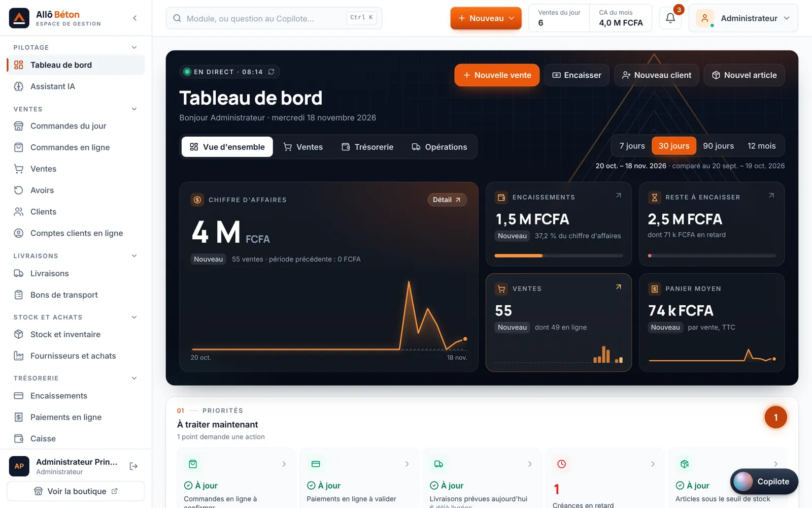
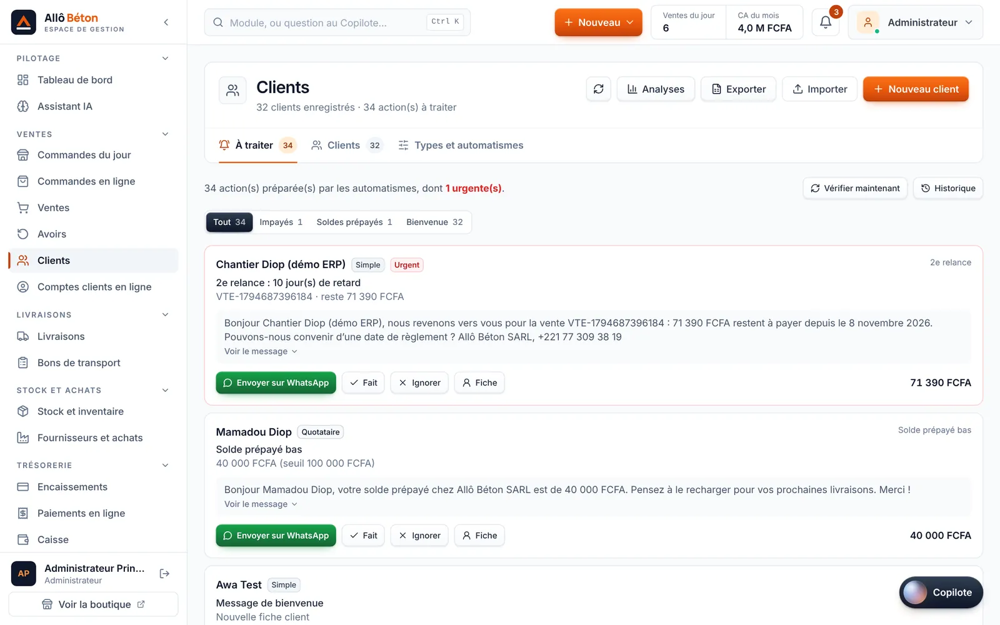
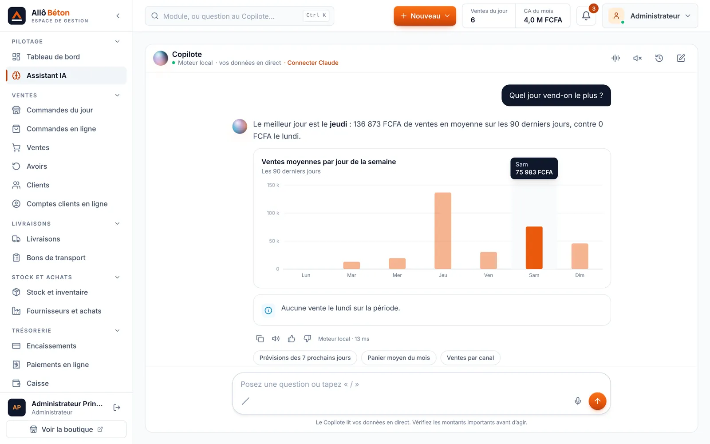
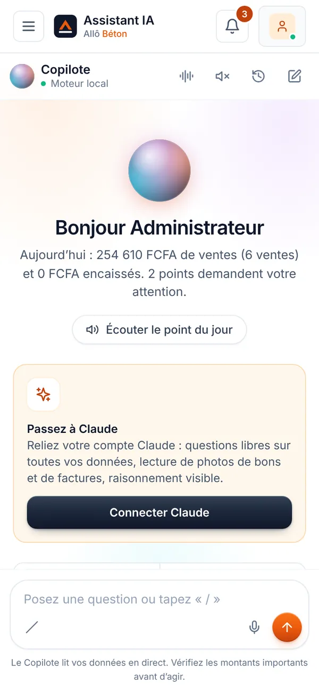

[← Retour au profil](README.md)

# Allô Béton · ERP et boutique en ligne

ERP sur mesure et boutique en ligne d’**ICOPS SUARL**, qui vend du silex et du basalte livrés sur les chantiers de Dakar.
Conçu et conduit par **Fatoumata Fall**, cheffe de projet et développeuse, depuis 2024.

> Le code source appartient à ICOPS SUARL et reste privé. Cette page présente ce que fait le logiciel, comment il est construit et comment il est testé.

## Ce que fait l’ERP

| Module | Rôle |
|---|---|
| Ventes et devis | Devis, ventes et factures, prix à la tonne en FCFA TTC, suivi des statuts |
| Clients 360 | Fiche client complète, types de clients, plafonds de crédit, relances WhatsApp |
| Stock et catalogue | Un seul catalogue pour la boutique et la gestion, entrées et sorties, alertes |
| Caisse et encaissements | Entrées et sorties, paiements, reste à encaisser, clôture de journée |
| Achats et fournisseurs | Fournisseurs, achats et livraisons sur les chantiers |
| Avoirs | Reliés à la vente d’origine, au stock et à la caisse |
| Documents PDF | Facture, devis, reçu, avoir et relevé client |
| Statistiques | Tableau de bord, graphiques et tableaux par période, client et produit |
| Copilote IA | Point du jour, questions en langage courant, actions soumises à confirmation |

## Une saisie, tous ses effets

Une vente enregistrée sort du stock, entre en caisse, met à jour le compte du client et apparaît dans le tableau de bord. Six liens automatiques relient les modules ; chaque écriture automatique garde son origine et ne se modifie pas à la main.

## Automatisations

- **Chaque heure**, l’ERP passe en revue les clients et prépare les actions du jour, message WhatsApp déjà rédigé (12 automatismes : bienvenue, rappel d’échéance, trois relances, plafond presque atteint, solde prépayé bas…).
- **Avant chaque vente**, les règles du type de client sont vérifiées : client bloqué, dette au-delà du plafond, retard.
- **Un encaissement** crée l’écriture de caisse ; **un avoir remboursé** passe la sortie de caisse.
- **Un bon de transport** fait passer la vente à « expédiée », puis « livrée ».
- **Un produit de retour en stock** prévient les clients qui l’attendaient.

## Livraisons

- Commande sans compte : un nom, un téléphone, un lieu choisi sur la carte.
- Tournées optimisées : ordre des arrêts calculé (plus proche voisin, puis 2-opt), kilomètres et durée estimés.
- Suivi en direct pour le client, liste des arrêts du jour pour le chauffeur.
- Code de remise à 4 chiffres : une commande ne passe « livrée » qu’avec le code du client.
- Zones de livraison : frais de base, frais par tonne et délai estimé.

## Copilote IA

Point du jour, questions en langage courant et réponses à la voix. Toute action qui modifie les données demande une confirmation. Évalué sur 748 questions avant sa mise en service ; fonctionne avec Claude (Anthropic) ou un moteur local.

 

## Architecture

- **Interface** : React, TypeScript, Vite, Tailwind CSS, Recharts, Leaflet
- **Application mobile** : Capacitor (Android, iOS)
- **Serveur** : Node.js, Express, MySQL / MariaDB, PDFKit
- **IA** : Claude (Anthropic SDK)
- **Messages** : WhatsApp, SMS, e-mail
- **Hébergement** : Docker, Railway, Railway, adresse courte https://fatoumayorofall-dev.github.io/allobeton/

## Qualité

- 1 222 tests automatiques
- 13 parcours testés de bout en bout
- 748 questions d’évaluation du copilote

## Mon rôle

Recueil des besoins, spécifications, modèle de données (64 tables), développement assisté par IA, tests, mise en ligne et formation des utilisateurs.

[← Retour au profil](README.md) · [Application en ligne](https://fatoumayorofall-dev.github.io/allobeton/) · [Structure de l’application](ARCHITECTURE.md) · [Démo](https://fatoumayorofall-dev.github.io/demo-erp/) · [LinkedIn](https://www.linkedin.com/in/fatoumata-fall-76ba851ba) · [Portfolio](https://fatoumayorofall-dev.github.io)
