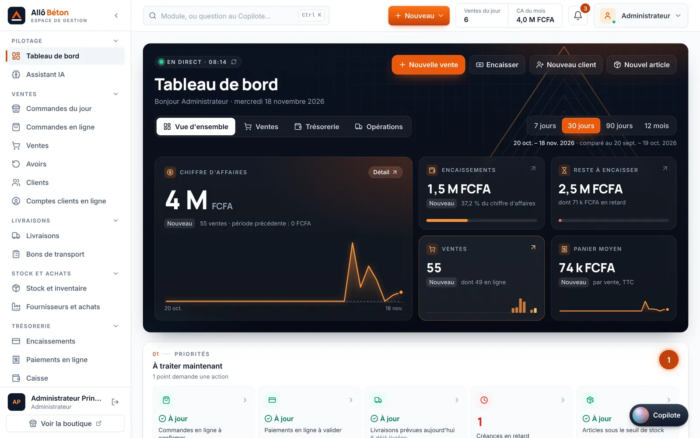

# Fatoumata Fall

**Cheffe de projet digital et développeuse ERP · Dakar, Sénégal**

Je conçois des ERP et des boutiques en ligne pour les PME : vente, stock, caisse, clients et livraisons, reliés dans un seul outil.
*Digital project lead and ERP developer in Dakar. I build ERPs and online shops for small businesses.*

[LinkedIn](https://www.linkedin.com/in/fatoumata-fall-ab2209265) · [Portfolio](https://claude.ai/artifact/9K6N5YEhBRefgBWcJVUzrn) · [Boutique Allô Béton](https://allobeton.sn) · fatoumayorofall@gmail.com

## Projet phare : l’ERP Allô Béton

ERP sur mesure et boutique en ligne d’ICOPS SUARL, qui livre du silex et du basalte sur les chantiers de Dakar. Je le conçois et le conduis depuis 2024.

- **Une saisie, tous ses effets** : une vente sort du stock, entre en caisse et met à jour le compte du client.
- **12 automatismes clients** : rappels d’échéance, relances WhatsApp, plafonds de crédit, solde prépayé.
- **Livraisons suivies** : tournées optimisées, suivi en direct, code de remise à 4 chiffres.
- **Copilote IA** : point du jour et questions en langage courant, évalué sur 748 questions.
- **Qualité** : 1 222 tests automatiques avant chaque mise en ligne.

**→ [Présentation complète de l’ERP : modules, automatisations, livraisons, architecture](ERP.md)**

## Outils

React · TypeScript · Node.js · Express · MySQL / MariaDB · Tailwind CSS · Capacitor · Claude (IA) · Docker · Railway · Power BI · Excel

## Parcours

- **2024 – aujourd’hui** · Cheffe de projet et développeuse, ICOPS SUARL (Allô Béton)
- **2021 – 2024** · Ministère de l’Éducation nationale : développeuse web (SIMEN), chargée de communication, formatrice
- **2023 – 2025** · Master 2 Management de la Transformation Digitale, spécialité Finance digitale, ESMT Dakar
- **2018 – 2021** · Licence Management Informatisé des Organisations, Université Assane Seck de Ziguinchor

## Langues

Français · Wolof · Anglais (professionnel)
