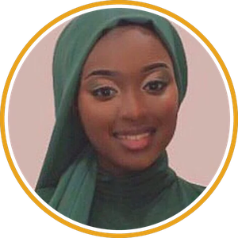
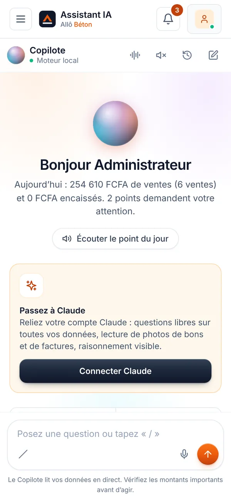

  

<h1 align="center">Fatoumata Fall</h1>

  <b>Cheffe de projet digital et développeuse ERP · Dakar, Sénégal</b> 
  Je conçois des ERP et des boutiques en ligne pour les PME : vente, stock, caisse, clients et livraisons, reliés dans un seul outil. 
  <i>Digital project lead and ERP developer in Dakar. I build ERPs and online shops for small businesses.</i>

  
  
  
  
  

  🟢 <b>Ouverte aux opportunités</b> : chef de projet ERP ou digital, consultante ERP, transformation digitale · Dakar, Sénégal et UEMOA · sur site, hybride ou à distance

---

## Projet phare : l’ERP Allô Béton

ERP sur mesure et boutique en ligne d’**ICOPS SUARL**, qui livre du silex et du basalte sur les chantiers de Dakar. Je le conçois et le conduis depuis 2024, du recueil des besoins à la formation des utilisateurs.

| **12** | **6** | **4 chiffres** | **1 222** |
|:---:|:---:|:---:|:---:|
| automatismes clients | liens automatiques entre modules | code qui prouve chaque livraison | tests automatiques |

- **Une saisie, tous ses effets** : une vente sort du stock, entre en caisse et met à jour le compte du client.
- **Automatisations** : chaque heure, l’ERP prépare les relances WhatsApp, surveille les plafonds de crédit et les soldes prépayés.
- **Livraisons suivies** : tournées optimisées, suivi en direct pour le client, code de remise à 4 chiffres pour le chauffeur.
- **Copilote IA** : point du jour et questions en langage courant, évalué sur 748 questions avant sa mise en service.
- **Sur ordinateur et téléphone** : application web, boutique en ligne et application mobile.

  
  &nbsp;
  

<b><a href="https://fatoumayorofall-dev.github.io/demo-erp/">▶ Essayer l’ERP de démonstration (données de test)</a></b>

<b><a href="ERP.md">→ Présentation complète de l’ERP : modules, automatisations, livraisons, architecture</a></b>

> Le code source appartient à ICOPS SUARL et reste privé. Cette page présente ce que fait le logiciel et comment il est construit. **Démonstration en direct et revue de code possibles lors d’un entretien.**

## Outils

-D97757?style=flat-square&logo=anthropic&logoColor=white)

## Ma méthode

1. **Comprendre le métier** : sur le terrain, avec ceux qui vendent, encaissent et livrent.
2. **Spécifier** : modèle de données, règles de gestion, écrans et cas limites, validés avec l’entreprise.
3. **Construire avec l’IA** : développement assisté par IA, relu et piloté module par module.
4. **Tester** : tests automatiques et parcours de bout en bout avant chaque mise en ligne.
5. **Mettre en ligne et former** : déploiement, formation de l’équipe, suivi des retours.

## Expérience

| Période | Poste |
|---|---|
| **nov. 2024 – aujourd’hui** | **Cheffe de projet et développeuse ERP**, ICOPS SUARL, Dakar (Allô Béton) |
| **févr. 2023 – juil. 2024** | **Formatrice**, Ministère de l’Éducation nationale, Diamniadio |
| **nov. 2022 – juil. 2024** | **Chargée de communication**, Ministère de l’Éducation nationale, Diamniadio |
| **déc. 2021 – janv. 2023** | **Développeuse web (stage)**, Ministère de l’Éducation nationale, SIMEN (Système d’information et de management de l’Éducation nationale) |
| **janv. 2019 – oct. 2020** | **Chargée de communication**, Bureau des étudiants, Université Assane Seck de Ziguinchor |

## Formation

| Années | Diplôme |
|---|---|
| **2023 – 2025** | **Master 2** Management de la Transformation Digitale, spécialité Finance digitale, ESMT Dakar |
| **2018 – 2021** | **Licence** Management Informatisé des Organisations, Université Assane Seck de Ziguinchor |
| **2018** | **Baccalauréat**, Cabis School, Dakar |

## Langues

Français · Wolof · Anglais (professionnel)

<b><a href="CV-Fatoumata-Fall.pdf">Télécharger mon CV (PDF)</a></b> · <a href="https://www.linkedin.com/in/fatoumata-fall-76ba851ba">Me contacter sur LinkedIn</a> · <a href="mailto:fatoumayorofall@gmail.com">fatoumayorofall@gmail.com</a>

